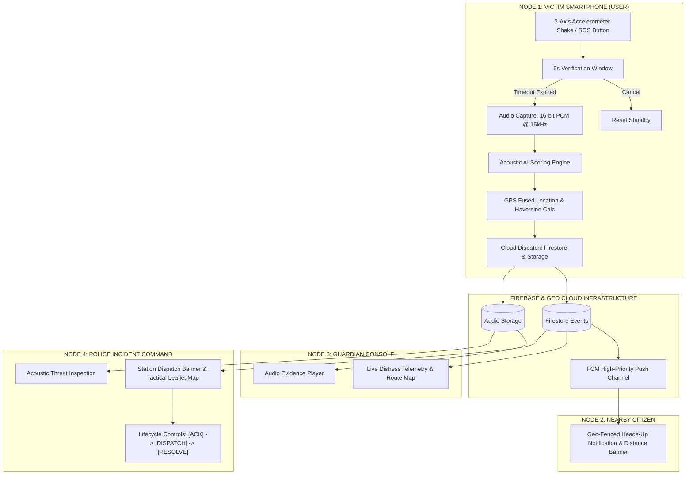
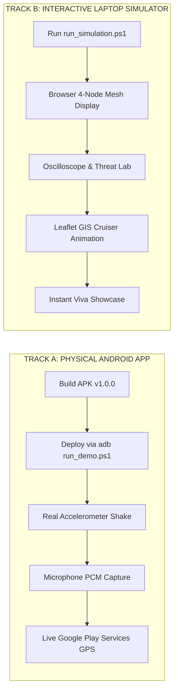

# DURGA: Project Master Plan & Defense Roadmap
### Dynamic Unified Response & Geo-Alert System
*Autonomous AI & Emergency Response Engineering — Semester 5 Mini Project*

---

## 1. Project Aim & Vision

### The Problem with Existing Safety Apps
Current emergency applications suffer from critical failure modes:
1. **Passive Speed Dialers**: Merely launch the phone dialer or send a generic SMS, requiring active interaction that a victim in physical danger cannot perform.
2. **High False Positive Rates**: Accidental button presses trigger unnecessary panic among family members.
3. **Zero Contextual Telemetry**: Responders receive no situational data—they do not know whether the victim is screaming, in a moving vehicle, or in immediate life threat.
4. **Disconnected Response Loop**: There is no direct synchronization between the victim, guardians, and police dispatch.

### DURGA's Core Aim
**DURGA** transforms personal emergency response into an **autonomous, end-to-end coordinated emergency engine**:
- **Zero-Friction Triggering**: Activated via deliberate 3-shake physical gesture (>2.7G) or one-tap SOS.
- **Fail-Safe Verification**: 5-second reversible cancellation countdown prevents false alarms.
- **Forensic Acoustic AI**: On-device 16-bit PCM waveform feature extraction (RMS volume, dBFS sound pressure, peak transients, zero-crossing turbulence) to classify threat severity without transmitting uncompressed raw audio prematurely.
- **Geospatial Tactical Dispatch**: Continuous GPS acquisition paired with real-time Haversine nearest police station routing.
- **Unified Multi-Role Mesh**: Synchronized real-time operational states across **Victim**, **Nearby Citizen**, **Trusted Guardian**, and **Police Incident Command (CAD)**.

$$\text{SENSE} \longrightarrow \text{VERIFY} \longrightarrow \text{RECORD} \longrightarrow \text{ASSESS} \longrightarrow \text{LOCATE} \longrightarrow \text{ALERT} \longrightarrow \text{RESPOND}$$

---

## 2. System Architecture

---

## 3. Dual-Track Demonstration Strategy

To ensure a flawless academic defense and classroom evaluation regardless of projector connectivity or physical hardware constraints, DURGA employs a **Dual-Track Presentation Strategy**:

### Track A: Physical Hardware & Native Android Stack
- **Target OS**: Android 8.0 (API 26) through Android 14 (API 34).
- **Core Stack**: Kotlin 1.9.24, Coroutines, Flow, Material 3 Dark Slate (`#0B1120`), Google Play Location, Firebase BoM 33.2.0.
- **Automated Verification**: `.\run_demo.ps1` automates device wakeup, permission grants, APK installation, and unit test execution.

### Track B: Interactive Laptop Multi-Node Simulator (`simulation/`)
- **Technology**: Vanilla HTML5, CSS3, JavaScript (ES6+), Leaflet.js GIS, Web Audio API.
- **Showcase Power**:
  - Displays all 4 operational nodes side-by-side on a single laptop screen.
  - Interactive accelerometer shake canvas with G-force vector plotting.
  - Live 16-bit PCM acoustic waveform oscilloscope.
  - Leaflet map displaying 5 Pune police stations with dynamic Haversine nearest-station vector and moving police patrol animation.
  - Forensic AI Acoustic Lab for live benchmarking of scream detection.

---

## 4. Current State & Readiness Assessment

| Area | Component | Status | Notes |
| :--- | :--- | :---: | :--- |
| **Toolchain** | Amazon Corretto JDK 17 | ✅ 100% | Verified (`D:\Java\jdk17.0.21_0`) |
| **Toolchain** | Android SDK & API 34 | ✅ 100% | Verified (`D:\Android\Sdk`, build-tools 34.0.0, adb) |
| **Toolchain** | Gradle Wrapper & Network | ✅ 100% | Gradle 8.9 downloaded, timeout configured |
| **Android Code** | Unit Test Suite | ✅ 100% | 27/27 tasks passing (`testDebugUnitTest`) |
| **Android Code** | APK Compilation | ✅ 100% | [app-debug.apk](file:///d:/Gourav/DURGA/app/build/outputs/apk/debug/app-debug.apk) (11.05 MB) built |
| **Backend** | Firebase Tools CLI | ✅ 100% | CLI v15.34.1 installed |
| **Backend** | Security & Rules | ✅ 100% | `firestore.rules` & `storage.rules` configured |
| **Simulation** | Multi-Node Web Simulator | ✅ 100% | Available via `run_simulation.ps1` on port 8085 |

---

## 5. Phased Execution Roadmap

### Phase 1: Simulator Experience & Presentation Polish
> **Goal**: Ensure the laptop simulator is 100% self-contained, visually striking, and responsive for live classroom projection.

- [ ] **1.1 Web Audio Integration**: Ensure simulated distress audio plays clearly without requiring external media assets.
- [ ] **1.2 Visual Telemetry Polish**: Enhance the dark-mode aesthetic with pulsing alert status badges and glowing telemetry indicators.
- [ ] **1.3 Automated One-Click Demo Mode**: Add an auto-play sequence that walks examiners through the entire incident lifecycle in 45 seconds.

### Phase 2: Live Physical Device Verification
> **Goal**: Validate APK behavior on a physical Android device or emulator.

- [ ] **2.1 Device Deployment**: Connect physical Android phone or configure AVD emulator.
- [ ] **2.2 Hardware Sensor Verification**: Test physical shake detection sensitivity and microphone WAV writer.
- [ ] **2.3 Offline Fallback**: Confirm that when airplane mode is enabled, local-first queueing prevents crashes.

### Phase 3: Project Defense & Academic Viva Deliverables
> **Goal**: Equip you with high-impact defense materials to score maximum marks.

- [ ] **3.1 Technical Viva Q&A Guide**: Comprehensive defense cheat-sheet covering:
  - Why Haversine over Euclidean distance?
  - Mathematical basis of RMS, dBFS, and Zero-Crossing Rate (ZCR).
  - Multi-role permission model and privacy safeguards.
- [ ] **3.2 Architecture & Flow Diagrams**: High-resolution diagrams for presentation slides.
- [ ] **3.3 Step-by-Step Viva Demonstration Script**: Exact 3-minute talking points for project defense.

---

## 6. Recommended Next Action

We can immediately proceed with **Phase 1** to verify and polish the **Interactive Laptop Simulator**, allowing you to preview the full system immediately in your browser.
